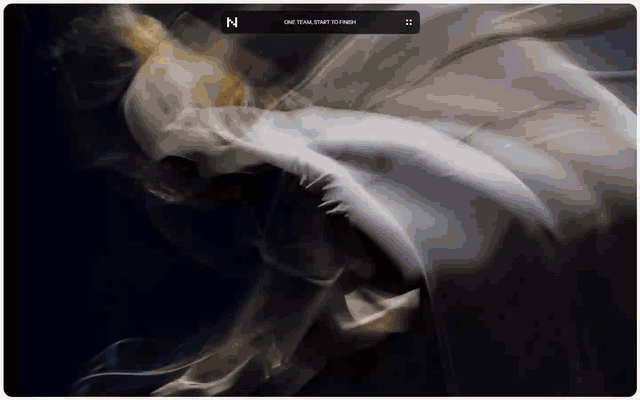

# Norvik Studio — native HTML site



An original studio site, **Norvik Studio**.
Plain HTML/CSS/JS, no build step needed to view, no hosting needed.

## How to open

- Double-click `index.html`. Everything (fonts, GSAP, Lenis, images, video) is local, so it works offline.
- Or serve it from this folder: `python -m http.server 5577` → http://127.0.0.1:5577

## Structure

```
index.html about.html work.html journal.html contact.html     main pages
404.html 401.html style-guide.html licenses.html changelog.html  utility pages
work/*.html                8 case studies
categories/*.html          6 work categories
journal/*.html             4 articles
journal-categories/*.html  4 journal categories
assets/css/style.css       all styles (fluid em scale)
assets/js/main.js          all interactions
assets/fonts/              Instrument Sans + Inter (woff2) and fonts.css
assets/vendor/             GSAP, ScrollTrigger, SplitText, Lenis
assets/img/                photos (+ credits.json), favicon.svg
assets/video/              studio reel + poster
docs/preview/              README preview (homepage.gif) + hero.png still
```

32 pages in total.

## Editing copy

Copy lives directly in the HTML pages; CSS and JS are in `assets/css/style.css` and `assets/js/main.js`.
Shared parts (nav, menu panel, footer) are repeated on every page, so change them everywhere.

## States & interactions included

Menu panel (open/close, scrim, staggered rows, Esc/click-outside), submenus (+ rotates to ×), row hover meta slide-in,
dot-glyph hover grow, button text-roll + arrow-chip swap, image hover zoom, work-card panel expand + "Discover case",
journal-index hover preview image, FAQ accordion, services/testimonial sliders (arrows + keyboard),
studio reel play/pause with live countdown, client marquee, scroll-scrubbed statement text, line-split heading reveals,
staggered fade-ups, sticky stacked core values, floating filter bar (work + journal), contact form validation
(error + success state, nothing is sent), 401 password form (wrong-password state; demo password `norvik`),
smooth scroll + same-page anchor scrolling, `prefers-reduced-motion` support.

## Placeholder / to replace

- Brand name, email `hello@norvik.studio`, phone, cities (Copenhagen — Porto).
- Client/project names, people, quotes, awards, numbers: all fictional.
- Logo and service glyphs are simple pixel marks drawn for this site.
- Photos: Unsplash (ids in `assets/img/credits.json`). Reel video: Mixkit #33899.
- The contact form and studio-profile PDF link do not send/download anything — wire them to your backend.
